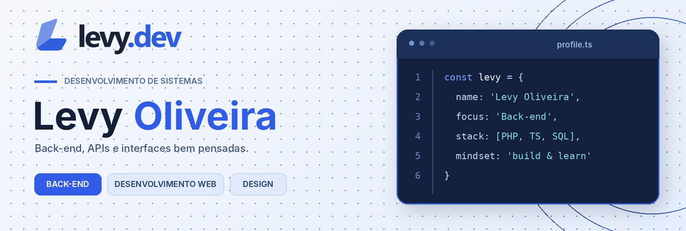
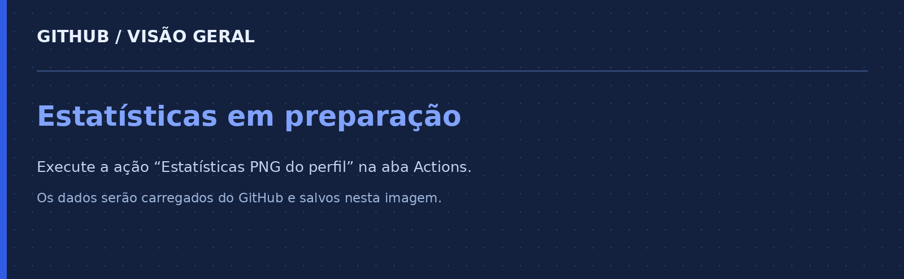

  

 

## Sobre

Sou estudante de **Desenvolvimento de Sistemas**, com foco em **back-end**, APIs e bancos de dados.

Tenho interesse em desenvolvimento web, organização de sistemas e interfaces bem estruturadas.

---

## Projetos em destaque

<table>
  <tr>
    <td width="50%" valign="top">
      <h3><a href="https://github.com/levyoliv/elo-platform">ELO</a></h3>
      
Plataforma universitária colaborativa com foco em comunidade, perguntas, respostas e compartilhamento de conhecimento.

      
<code>Next.js</code> <code>TypeScript</code> <code>Supabase</code>

    </td>
    <td width="50%" valign="top">
      <h3><a href="https://github.com/levyoliv/crud">CRUD</a></h3>
      
Projeto para prática de cadastro, listagem e gerenciamento de dados.

      
<code>PHP</code> <code>MySQL</code>

    </td>
  </tr>
  <tr>
    <td width="50%" valign="top">
      <h3><a href="https://github.com/levyoliv/plantech">Plantech</a></h3>
      
Projeto web voltado à construção e organização de interface.

      
<code>HTML</code> <code>CSS</code>

    </td>
    <td width="50%" valign="top">
      <h3>VÉSPERA</h3>
      
Projeto conceitual de jogo de estratégia territorial.

      
<code>Game Design</code> <code>Estratégia</code>

    </td>
  </tr>
</table>

---

## Tecnologias

### Back-end e linguagens
`PHP` `JavaScript` `TypeScript` `Python` `Node.js` `CodeIgniter` `Express` `Laravel`

### Front-end
`HTML5` `CSS3` `React` `Next.js` `Tailwind CSS` `Vite`

### Banco de dados e ferramentas
`MySQL` `PostgreSQL` `SQLite` `MongoDB` `Git` `GitHub` `Docker` `VS Code`

### Design
`Figma` `Canva` `Photoshop` `Illustrator`

---

## GitHub em números

  

---

## Contato

- **LinkedIn:** [linkedin.com/in/levyoliveira](https://www.linkedin.com/in/levyoliveira)
- **GitHub:** [github.com/levyoliv](https://github.com/levyoliv)
- **Instagram:** [instagram.com/levyoliv__](https://instagram.com/levyoliv__)
- **E-mail:** [levyoliveira654@gmail.com](mailto:levyoliveira654@gmail.com)

 

  

